# Ignacio Badenes

**Técnico de Sistemas · Informática Aplicada y Soporte**  
Especialista en automatización, datos y desarrollo local-first · Castellón de la Plana, España

---

## Sobre mí

Técnico informático con formación reglada en sistemas y entornos digitales. Perfil **responsable, organizado y metódico**, centrado en la gestión de datos, resolución de incidencias y aplicación rigurosa de protocolos operativos. Trabajo con autonomía, puntualidad y rápida adaptación a flujos de equipo.

Fuera del día a día, construyo y publico **herramientas propias** de automatización y tratamiento de datos: proyectos reales, con tests, documentación y licencia, para que quien los use confíe en lo que hace el programa.

| Competencia | Detalle |
|-------------|---------|
| **🖥️ Sistemas y soporte** | Mantenimiento HW/SW · Instalación y configuración Windows/Linux · Redes locales · Resolución incidencias Nivel 1 |
| **🗂️ Datos y ofimática** | Procesamiento masivo de archivos · Actualización de BBDD · Verificación de datos web · Ofimática avanzada + IA aplicada |
| **🛡️ Operativa y protocolos** | Supervisión de accesos · Gestión de incidencias · Atención y registro de usuarios · Cumplimiento normativas seguridad |
| **🌐 Idiomas** | Español (nativo) · Inglés técnico (lectura fluida de documentación) |

---

## Proyectos destacados

Seis desarrollos autónomos, publicados y mantenidos. Cada uno resuelve un problema concreto desde una óptica distinta: **seguridad, criptografía, datos, automatización, rendimiento y RAG local**.

| Proyecto | Stack | Descripción | Métricas |
|----------|-------|-------------|----------|
| **[LexiForge](https://github.com/yosoyignicion/LexiForge)** | `Python` `PyMuPDF` `SQLite FTS5` `Ollama` `Streamlit` | Motor local anti-paywall para opositores e investigadores: indexa PDFs masivos (+800 págs), búsqueda híbrida BM25⊕vectores, RAG con streaming, fichas EPUB/Markdown y examen interactivo. **0 SDKs externos**. | `31 tests` ✅ · `~2k líneas` · Huella SHA-256 + dedup · RRF híbrido |
| **[Aethernet](https://github.com/yosoyignicion/Aethernet)** | `Python` `NiceGUI` `FastAPI` `SQLite` `nmcli` `scapy` | Audita tu WiFi doméstico sin salir de tu equipo: escaneo pasivo, motor de reglas (evil twin, deauth, canal saturado), inventario LAN y monitor no disruptivo. Todo 100% local, sin nube ni telemetría. | `146 tests` ✅ · `CI verde (3.11/3.12)` · `mypy --strict 0 errores` |
| **[LocalGrant-Finder](https://github.com/yosoyignicion/LocalGrant-Finder)** | `Python` `FastAPI` `pgvector` `SQLite/PostgreSQL` `Docker` | Convierte el BOE en decisiones de financiación: ingiere y normaliza subvenciones públicas, búsqueda híbrida (BM25 + semántica) y seguimiento por fases. Funciona offline, sin API keys. | `69 tests` ✅ · `CI verde` · `Migraciones Alembic` |
| **[SystemBridge-AI](https://github.com/yosoyignicion/SystemBridge-AI)** | `Python` `FastAPI` `OCR` `LLM local` `Docker` | Transforma facturas, tickets y escaneos en libro contable equilibrado y auditable: lectura determinista + OCR, valida totales y envía lo dudoso a revisión humana. | `71 tests` ✅ · `Métricas Prometheus` · `Decimal, nunca float` · `Idempotente` |
| **[pass-encrypt-env](https://github.com/yosoyignicion/pass-encrypt-env)** | `Python` `GTK3` `Argon2id` `AES-256-GCM` `TOTP` `systemd` | Bóveda local de secretos con contraseña maestra + 2FA TOTP y agente de sesión: sirve claves API a tus apps todo el escritorio sin volver a pedir nada. Cifrado en reposo, cero nube, proceso endurecido. | `19 tests` ✅ · `CI verde` · `Argon2id + AES-256-GCM` · `bandit limpio` |
| **[AssetShrink](https://github.com/yosoyignicion/AssetShrink)** | `C++17` `WebP` `CMake` `Multiplataforma` | Comprime y convierte imágenes en lote al 100% en local, sin subir nada a servidores. Motor multihilo, comparador visual y binarios listos para Linux, macOS y Windows. | `Release v1.0.0` · `CI en 3 sistemas` · `1 ⭐` |

---

## Descargas

| Archivo | Descripción |
|---------|-------------|
| [📄 CV Técnico - Ignacio Badenes (PDF)](./CV%20T%C3%A9cnico%20-%20Ignacio%20Badenes.pdf) | Currículum actualizado: formación, experiencia, competencias técnicas y proyectos |

---

## Herramientas

`Windows` · `Linux` · `Redes locales` · `Ofimática avanzada` · `Python` · `FastAPI` · `SQL` · `Git` · `Docker` · `Automatización` · `IA aplicada` · `C++` · `TypeScript` · `Astro`

---

## ¿Trabajamos juntos?

Si has llegado hasta aquí, ya sabes cómo trabajo: **con método, con tests y sin promesas que no pueda sostener**. Busco un equipo donde aportar esa base sólida de sistemas y datos, y seguir creciendo rodeado de gente que cuida el detalle.

Si tu proyecto necesita a alguien puntual, ordenado y con muchas ganas de aprender —o solo quieres contrastar una idea— escríbeme. Respondo siempre, y con gusto.

---

## Contacto

| Canal | Enlace |
|-------|--------|
| ✉️ **Email** | [nbrbadenes99@gmail.com](mailto:nbrbadenes99@gmail.com) |
| 🌐 **Enlaces & formulario** | [yosoyignicion.netlify.app/links](https://yosoyignicion.netlify.app/links) |

📍 **Castellón de la Plana, España**

---

Perfil de <strong>Ignacio Badenes</strong> · <a href="https://github.com/yosoyignicion">github.com/yosoyignicion</a> · Construido con 🔥 y cero telemetría

